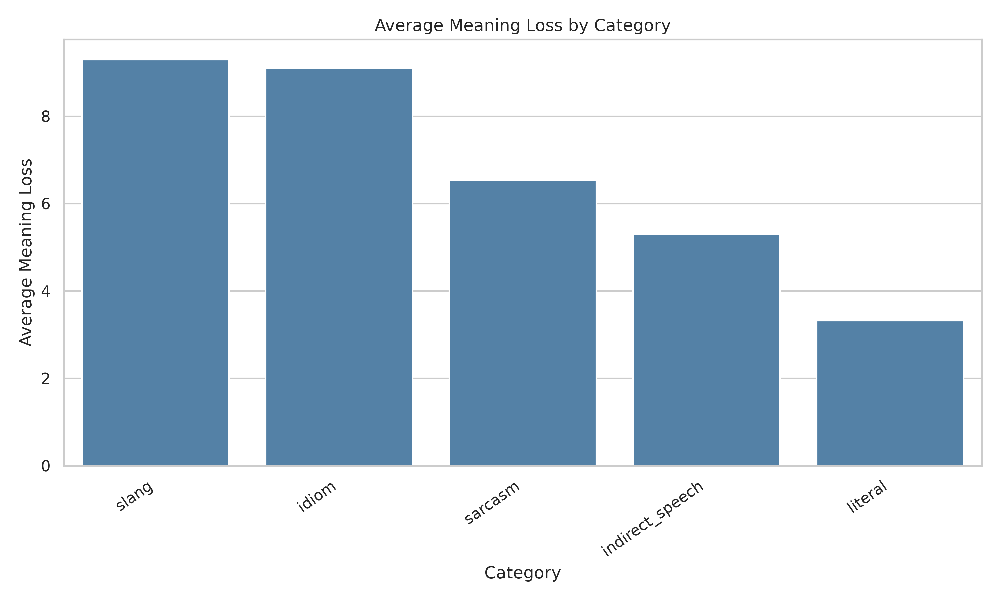
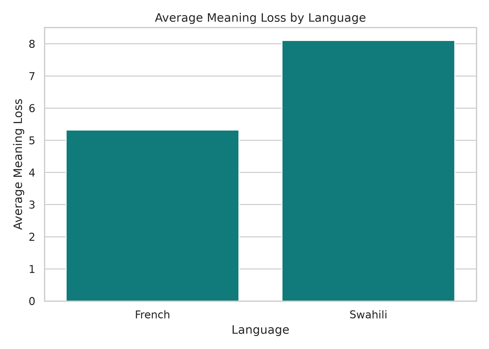
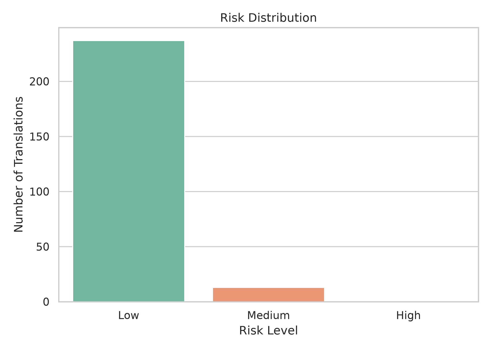
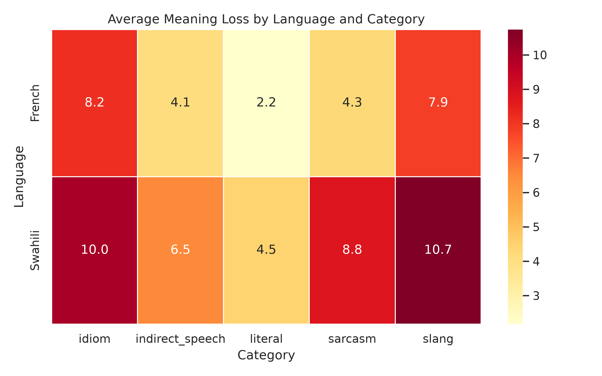

# MeaningGuard

MeaningGuard measures meaning loss during AI translation and highlights cases
where a round-trip translation may have lost important meaning. This research
prototype compares English text with its English back-translation after
translation into French or Swahili.

## Project Overview

MeaningGuard explores how different kinds of language fare during AI
translation. Each input passes through an English-to-target-language-to-English
workflow, and an embedding-based similarity score estimates how closely the
back-translation preserves the source meaning. The score is converted into a
meaning-loss value and a Low, Medium, or High risk category.

The current repository provides a batch analysis pipeline and visualizations;
it does not include a deployed user-facing warning interface.

## Problem Statement

Machine translation can preserve the general topic of a sentence while
changing nuance, intent, or non-literal meaning. Idioms, slang, sarcasm, and
indirect speech may be especially sensitive to these shifts. MeaningGuard
investigates whether a consistent round-trip scoring workflow can help surface
potential meaning loss for further review.

## Research Question

**Which types of language lose the most meaning during AI translation?**

## Core Innovation

MeaningGuard combines a multilingual translation model with semantic
similarity scoring to provide a simple, comparable signal of meaning
preservation. It evaluates examples across multiple language categories and
target languages, then summarizes scores with category comparisons, language
comparisons, and risk classifications.

The score is an automated screening signal, not a guarantee of correctness or
a replacement for human review.

## Methodology

For each English dataset example, MeaningGuard:

1. Translates the text from English into French or Swahili using NLLB-200.
2. Translates the result back into English using NLLB-200.
3. Encodes the original and back-translated English text with
   `sentence-transformers/paraphrase-multilingual-MiniLM-L12-v2`.
4. Calculates normalized cosine similarity between the sentence embeddings.
5. Computes meaning loss and assigns a risk category.

The scoring formula is:

```text
Meaning Loss = (1 - similarity) × 100
```

Here, `similarity` is normalized to the range `[0, 1]`; lower similarity
therefore produces a higher meaning-loss score. The project classifies scores
below 20 as Low risk, scores from 20 to below 40 as Medium risk, and scores of
40 or above as High risk.

For additional detail, see [docs/methodology.md](docs/methodology.md).

## Technology Stack

- **Translation:** Meta NLLB-200 (`facebook/nllb-200-distilled-600M`)
- **Semantic similarity:** Sentence Transformers,
  `sentence-transformers/paraphrase-multilingual-MiniLM-L12-v2`
- **Machine learning runtime:** PyTorch and Transformers
- **Data processing:** Python, pandas, and NumPy
- **Visualizations:** Matplotlib and Seaborn

## Dataset Description

The pipeline uses [`data/meaningguard_dataset.csv`](data/meaningguard_dataset.csv),
which contains 125 English examples, balanced across five categories:

| Category | Examples |
|---|---:|
| Literal language | 25 |
| Idiom | 25 |
| Sarcasm | 25 |
| Slang | 25 |
| Indirect speech | 25 |

Each example has an ID, category label, and English text. Both target-language
experiments use the same source examples, resulting in 250 translation
observations: 125 French and 125 Swahili. The 125 sentences were manually
created and evenly divided among the five categories. See the
[dataset documentation](docs/dataset.md) for its structure, creation process,
and limitations.

## Repository Structure

```text
MeaningGuard/
├── data/
│   └── meaningguard_dataset.csv
├── docs/
│   ├── dataset.md
│   ├── demo_script.md
│   ├── findings.md
│   └── methodology.md
├── results/
│   ├── final_results.csv
│   ├── french_results.csv
│   └── swahili_results.csv
├── src/
│   ├── run_pipeline.py
│   ├── scoring.py
│   ├── similarity.py
│   └── translate.py
├── visualizations/
│   ├── category_loss.png
│   ├── create_charts.py
│   ├── heatmap.png
│   ├── language_comparison.png
│   └── risk_distribution.png
└── requirements.txt
```

## Installation

Use Python 3.10 or later. From the repository root, create and activate a
virtual environment, then install the dependencies:

```bash
python -m venv .venv
```

On macOS or Linux:

```bash
source .venv/bin/activate
```

On Windows PowerShell:

```powershell
.\.venv\Scripts\Activate.ps1
```

Install project requirements:

```bash
python -m pip install --upgrade pip
python -m pip install -r requirements.txt
```

The first pipeline run downloads the translation and similarity model
checkpoints. An internet connection and sufficient disk space are required
unless the model files are already cached.

## Running the Pipeline

From the repository root, run:

```bash
python src/run_pipeline.py
```

The pipeline processes every dataset row in French and Swahili experiments.
It writes each language's CSV after that experiment completes, then writes
the combined file after both experiments finish:

- `results/french_results.csv`
- `results/swahili_results.csv`
- `results/final_results.csv`

Each result row includes the source and translated texts, semantic similarity,
meaning-loss score, and risk classification.

To regenerate the charts after running the pipeline:

```bash
python visualizations/create_charts.py
```

## Visualizations

The following charts are available in [`visualizations/`](visualizations/):

### Average Meaning Loss by Category



### Average Meaning Loss by Language



### Risk Distribution



### Average Meaning Loss by Language and Category



## Results

The current output contains **250 total translations**: **125 French** and
**125 Swahili**. The highest category-average meaning loss was observed for
slang; the lowest was observed for literal language.

### Average Meaning Loss by Category

| Category | Average meaning loss |
|---|---:|
| Slang | 9.294 |
| Idiom | 9.100 |
| Sarcasm | 6.542 |
| Indirect speech | 5.300 |
| Literal language | 3.316 |

### Average Meaning Loss by Language

| Language | Average meaning loss |
|---|---:|
| Swahili | 8.105 |
| French | 5.316 |

### Risk Distribution

| Risk level | Translations | Percentage |
|---|---:|---:|
| Low | 237 | 94.8% |
| Medium | 13 | 5.2% |
| High | 0 | 0.0% |

These are descriptive results for the current dataset and model configuration.
Read the full [findings summary](docs/findings.md) for interpretation and
caveats.

## Limitations

- Back translation is an indirect way to assess meaning preservation and may
  reflect errors from either translation direction.
- Embedding similarity is an automated proxy; it may not capture pragmatic
  intent, cultural context, factual correctness, or all forms of nuance.
- The dataset is small and balanced across its five categories, and its
  provenance and annotation process are not documented.
- Only French and Swahili are evaluated, using one translation model and one
  similarity model.
- The risk thresholds are project-defined and have not been documented as
  calibrated against human judgments or downstream impact.
- The reported comparisons are descriptive; they do not establish statistical
  significance or generalize to all text or translation systems.

## Future Work

- Expand the dataset and document its sourcing and annotation guidelines.
- Add more languages, translation systems, and translation directions.
- Compare automated scores with expert and native-speaker judgments.
- Evaluate score reliability and calibrate risk thresholds against human
  assessment.
- Analyze performance by category, language, and relevant text characteristics
  with appropriate statistical methods.
- Build an interactive interface that lets users review flagged translations
  and their source context.

## Authors

### Project

**MeaningGuard** — a high school hackathon research project exploring meaning
preservation in AI translation.

### Team

- **Team name:** [Insert team name]
- **School or organization:** [Insert school or organization]
- **Team members:** [Insert member names]
- **Hackathon:** [Insert hackathon name and year]

### Repository

[github.com/Joawyo/MeaningGuard](https://github.com/Joawyo/MeaningGuard)

### Contributions

The team collaboratively developed MeaningGuard, including:

- Formulating the research question and creating a balanced, hand-crafted
  English dataset.
- Implementing the English-to-French and English-to-Swahili translation
  round-trip pipeline.
- Measuring semantic similarity, calculating meaning-loss scores, and
  assigning project-defined risk categories.
- Analyzing the results and creating visualizations and project
  documentation.

Replace the placeholders above with the participating students' and team's
details before submission.
